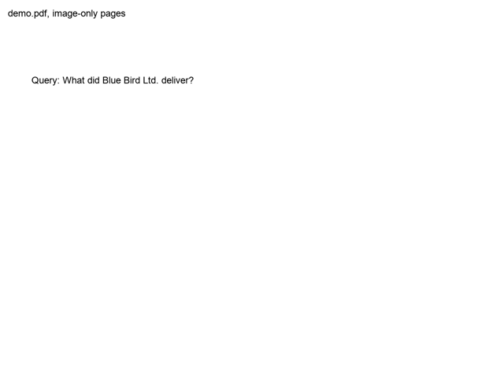
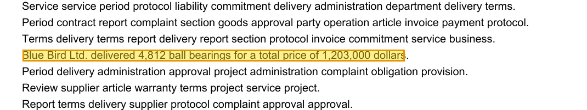
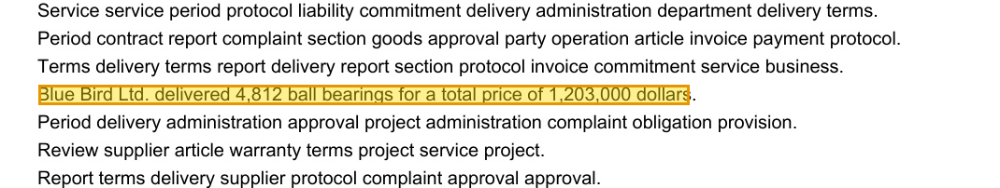

# pdfjev

Find the answer to a question in a scanned PDF and highlight it, using only yes/no questions about images.



## Examples

All on the same 200-page image-only PDF, with Jev.

### One answer

```sh
uv run pdfjev.py "How much did the bearings cost?"
```

Page 142, error 8 px, 9.9 s, 71 requests, $0.013. [Video](media/single.mp4) · [GIF](media/single.gif)



### More answers

```sh
uv run pdfjev.py "What did Blue Bird Ltd. deliver?" --answers 0
```

Pages 64 and 142, error 8 px and 8 px, 13.7 s, 133 requests, $0.017. [Video](media/multi.mp4) · [GIF](media/multi.gif) (the GIF at the top)




### Moves scaled by probability

```sh
uv run pdfjev.py "Where is the basement key hidden?" --mover prob
```

Page 37, error 14 px, 13.0 s, 58 requests, $0.012. [Video](media/prob.mp4) · [GIF](media/prob.gif)


## How it works

The PDF has no text layer. Every page is just an image. A decision model never writes text and never returns coordinates; it only answers yes or no. All the work is done by halving:

1. **Find the page.** Put two pages side by side into one image, 100 images in 4 parallel requests, with one question per page: *"Does page 142 contain the answer?"* The pages on images that say yes are sent once more one by one, because the model sometimes mixes up the left and the right page.
2. **Split the page.** Cut the page image into 4 overlapping crops at once: *"Does this crop contain the whole answer?"* Keep the crops that say yes, repeat until a thin strip is left.
3. **Highlight.** The model places 4 points, like on a canvas:
   - a red line moves up and down until it sits just above and just below the answer,
   - then everything except a part of the answer line is blanked out and the model is asked *"Is any letter visible?"* to find the left and right edge.

   Top and bottom run in parallel, then left and right. Each edge sends 3 probes at once and moves to the boundary that fits the answers best. Every probe is asked twice, once inverted (*"Does the line touch the text or lie below it?"*), and the two answers are averaged.

   The 4 corners become the highlight, and the model is done.

## Run

```sh
export TYPESAFE_API_KEY=...
uv run make_demo_pdf.py
uv run pdfjev.py "How much did the bearings cost?"
```

`make_demo_pdf.py` creates `demo.pdf`, 200 image-only pages with three hidden sentences, plus `demo_truth.json` with their real positions. The truth file is only used to print the error at the end; the model never sees it.

Output goes to `out/`: the highlighted pages, `demo.gif` and `demo.mp4`. At the end it prints time, decisions, tokens and USD per phase.

| Option | Default | |
|---|---|---|
| `--answers N` | `1` | how many pages with the answer to highlight, `0` = all |
| `--mover bisect` | ✓ | each edge: 3 parallel probes per round, confidence-weighted |
| `--mover prob` | | each edge moves by `step × (2p − 1)` px; the step halves when the direction flips |
| `--step PX` | `80` | largest move for `--mover prob` |

```sh
uv run pdfjev.py "What did Blue Bird Ltd. deliver?" --answers 0
uv run pdfjev.py "Where is the basement key hidden?" --mover prob --step 120
```

## Swap the decision model

Both backends answer the same yes/no question, so switching is one import in `pdfjev.py`:

```python
from deciders import TypeSafeJev as Decider
```

```python
from deciders import OpenAIDecisions as Decider
```

| Backend | Model | Key |
|---|---|---|
| `TypeSafeJev` | [Jev](https://typesafe.ai) `jev-preview` | `TYPESAFE_API_KEY` |
| `OpenAIDecisions` | OpenAI Decisions API `gpt-6-luna` | `OPENAI_API_KEY` |

You can also call it from code:

```python
from deciders import OpenAIDecisions
from pdfjev import find_and_highlight

find_and_highlight("demo.pdf", "Where is the basement key hidden?", OpenAIDecisions())
```

A new backend only needs one method, `probability(state, question, images) -> float`.

## Speed and cost

200 pages, one answer, Jev, MacBook:

| Phase | Time | Requests | Tokens | USD |
|---|---|---|---|---|
| render pages | 1.4 s | 0 | 0 | 0 |
| find page | 3.3–4 s | 5 | 208k | 0.009 |
| split + highlight | 4–5 s | 66 | 92k | 0.004 |
| **total** | **~9–10 s** | 71 | 300k | **0.013** |

Prices: Jev $0.042 / 1M input tokens, OpenAI Decisions `gpt-6-luna` $0.10 / 1M input tokens, output is free for both.

What the tokens are spent on:

- Every image costs about 2,000 tokens, no matter its resolution. Two pages fit into one image and still read fine, four do not.
- A question costs only about 25 tokens, so one request asks about every page in it at once instead of doing more rounds.
- An image is inserted wherever its name appears, also inside question text. Image names are replaced with random ids before sending, so an image is never counted twice.
- Most of the cost is the page search, because every page has to be shown once.

## Results on the demo

Highlight error against the real position of the sentence:

| Query | Pages | `bisect` | `prob` |
|---|---|---|---|
| How much did the bearings cost? | 142 | 8 px | 7 px |
| Where is the basement key hidden? | 37 | 10 px | 14 px |
| When does the new branch director start? | 188 | 10 px | 9 px |
| What did Blue Bird Ltd. deliver? (`--answers 0`) | 64, 142 | 8, 8 px | 8, 7 px |

With OpenAI Decisions the page and the strip are found just as well, but the red line question is answered poorly, so the highlight is off by about 200 px.

The demo is easier than a real scan: the hidden sentence is the only meaningful one among random words, and the pages are clean.

## Notes

- Jev accepts images only with `jev-preview`, needs the short image side of at least ~280 px and an aspect ratio up to ~3:1. Images are padded to fit.
- At most 50 page images go into one request.
- Image names in `state` are swapped for random ids by `deciders.py`, so never reuse an image name inside question text by hand.
- Fonts are loaded from the macOS system font folder; change the paths at the top of `pdfjev.py` and `make_demo_pdf.py` on other systems.
