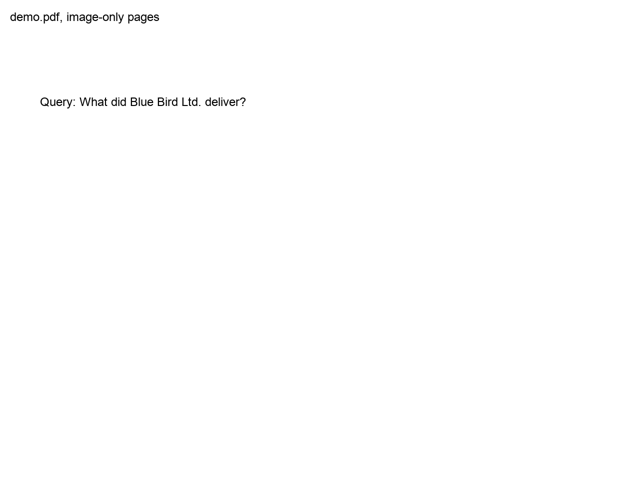

# pdfjev

Find the answer to a question in a scanned PDF and highlight it, using only yes/no questions about images.



Full video: [media/demo.mp4](media/demo.mp4)

The PDF has no text layer. Every page is just an image. A decision model never writes text and never returns coordinates; it only answers yes or no. All the work is done by halving:

1. **Find the page.** Show the model half of the pages: *"Does any of these pages answer the query?"* Keep the half that says yes, repeat until one page is left.
2. **Split the page.** Cut the page image into a top and a bottom half: *"Does this crop contain the whole answer?"* Keep halving until a thin strip is left.
3. **Highlight.** The model places 4 points, like on a canvas:
   - a red line moves up and down until it sits just above and just below the answer,
   - then everything except a part of the answer line is blanked out and the model is asked *"Is any letter visible?"* to find the left and right edge.

   The 4 corners become the highlight, and the model is done.

For 200 pages this takes about 50 yes/no decisions.

## Run

```sh
export TYPESAFE_API_KEY=...
uv run make_demo_pdf.py
uv run pdfjev.py "How much did the bearings cost?"
```

`make_demo_pdf.py` creates `demo.pdf`, 200 image-only pages with three hidden sentences, plus `demo_truth.json` with their real positions. The truth file is only used to print the error at the end; the model never sees it.

Output goes to `out/`: the highlighted page, `demo.gif` and `demo.mp4`.

## Swap the decision model

Both backends answer the same yes/no question, so switching is one import in `pdfjev.py`:

```python
from deciders import TypeSafeJev as Decider
```

```python
from deciders import OpenAIDecisions as Decider
```

| Backend | Model | Key |
|---|---|---|
| `TypeSafeJev` | [Jev](https://typesafe.ai) `jev-preview` | `TYPESAFE_API_KEY` |
| `OpenAIDecisions` | OpenAI Decisions API `gpt-6-luna` | `OPENAI_API_KEY` |

You can also call it from code:

```python
from deciders import OpenAIDecisions
from pdfjev import find_and_highlight

find_and_highlight("demo.pdf", "Where is the basement key hidden?", OpenAIDecisions())
```

A new backend only needs one method, `probability(state, question, images) -> float`.

## Results on the demo

| Query | Page | Jev error | OpenAI error |
|---|---|---|---|
| How much did the bearings cost? | 142 | 9 px | 287 px |
| Where is the basement key hidden? | 37 | 9 px | 124 px |
| When does the new branch director start? | 188 | 11 px | 163 px |

Both backends find the right page and the right strip. OpenAI finds the left and right edges well but struggles with the red line question, so its highlight spans several lines.

## Notes

- Jev accepts images only with `jev-preview`, needs the short image side of at least ~280 px and an aspect ratio up to ~3:1. Images are padded to fit.
- At most 50 page images go into one request.
- Fonts are loaded from the macOS system font folder; change the paths at the top of `pdfjev.py` and `make_demo_pdf.py` on other systems.
