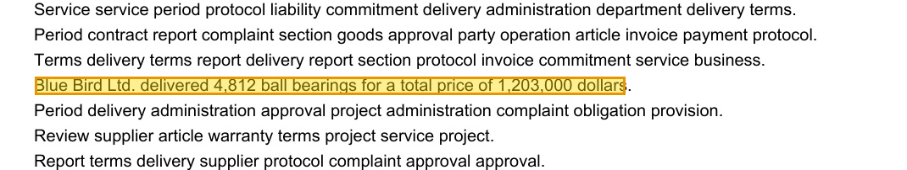
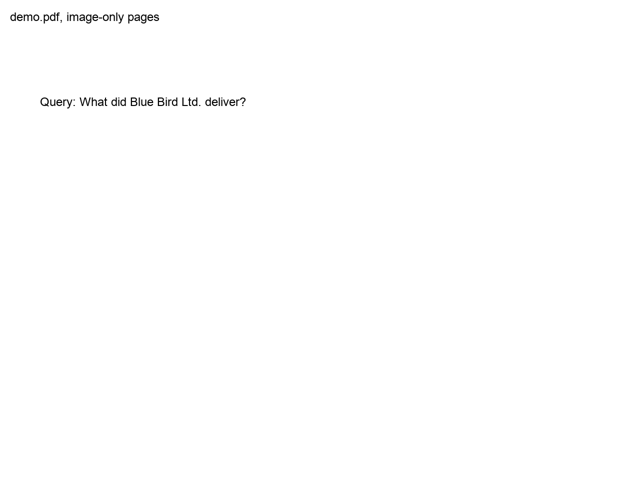
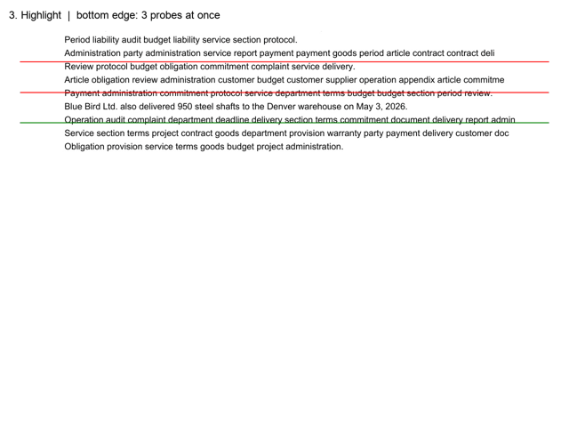

# pdfjev

Find the answer to a question in a scanned PDF and highlight it. The model only ever answers yes or no about images, the script does the rest.

```sh
export TYPESAFE_API_KEY=...
uv run make_demo_pdf.py                       # demo.pdf: 200 image-only pages
uv run pdfjev.py "How much did the bearings cost?"
```



## 1. Search



1. Put two pages side by side into one image, 100 images for 200 pages.
2. Send them in 4 parallel requests and ask one question per page: *"Is the answer on page 142?"*
3. Pages that say yes are checked once more on their own, because the model sometimes mixes up left and right.
4. On the found page, cut 4 overlapping crops and ask *"Is the whole answer in this crop?"* Repeat on the crop that says yes until only a few lines are left.

## 2. Highlight



1. **Top and bottom:** draw a red line and ask *"Is the line above the answer without touching it?"* Move the line until the answer flips from yes to no.
2. **Left and right:** blank out everything except part of the answer line and ask *"Is any letter visible?"* Move the edge until the answer flips.
3. Each probe is asked twice, once inverted, and the answers are averaged.
4. The 4 edges give 4 corners, the 4 corners give the highlight.

Full run as a video: [media/demo.mp4](media/demo.mp4)

## Options

| | |
|---|---|
| `--answers N` | highlight N pages with the answer, `0` = all |
| `--mover prob` | move each edge by `step × (2p − 1)` px instead of bisecting |
| `--step PX` | largest move for `--mover prob`, default 80 |

The decision model is one import in `pdfjev.py`: `TypeSafeJev` (default) or `OpenAIDecisions`.

## Cost

200 pages: ~10 s, ~$0.013 with Jev, highlight within ~7–14 px on the demo. Every image costs ~2,000 tokens, a question only ~25, so the script sends few images and asks many questions about each.
